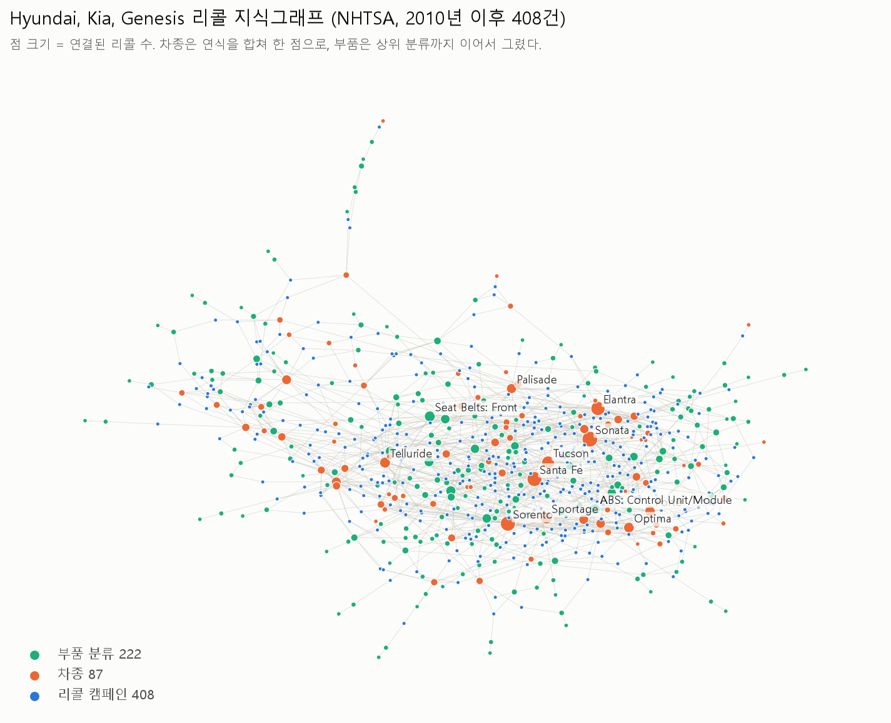
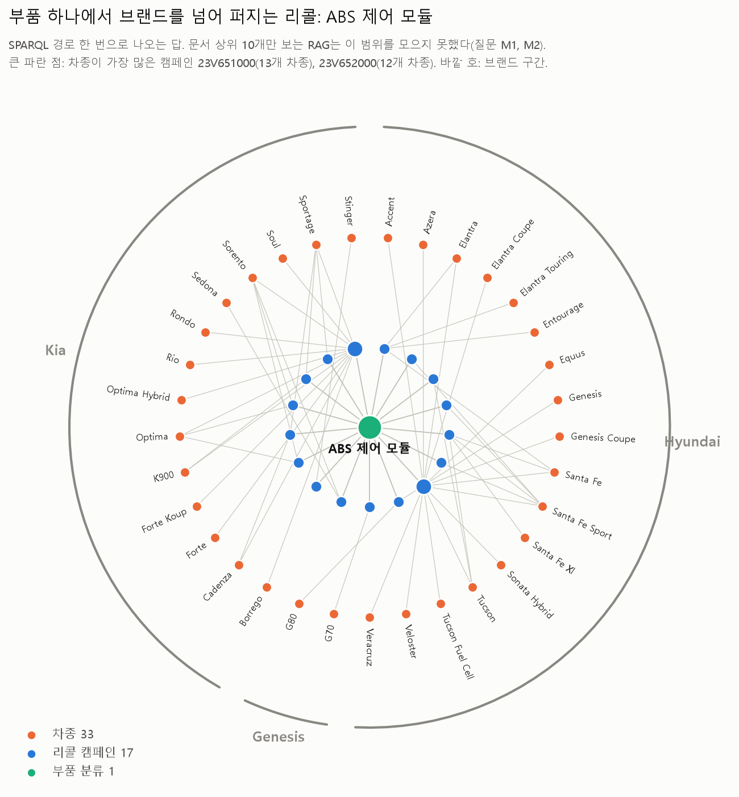
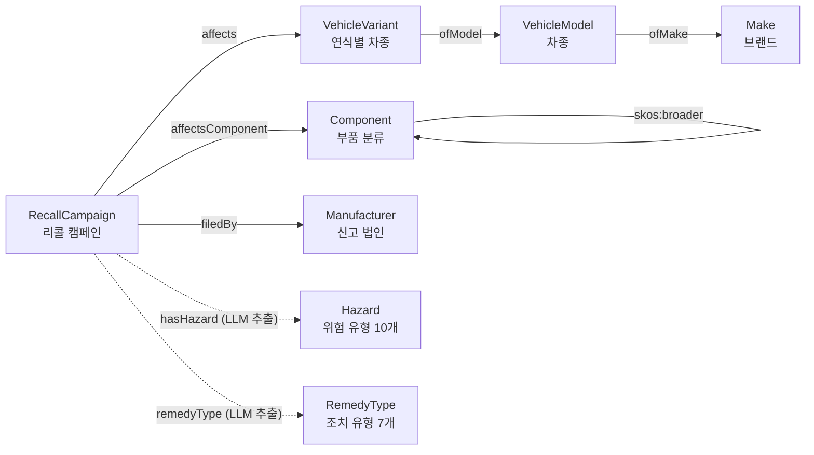

# kg-recall-poc — 리콜 데이터로 만든 온톨로지 기반 지식그래프 RAG PoC

[](https://github.com/songjeongwoo/kg-recall-poc/actions/workflows/test.yml)

미국 NHTSA(National Highway Traffic Safety Administration, 도로교통안전국)의 공개 리콜 데이터 중
Hyundai, Kia, Genesis 리콜 캠페인 408건(2010년 이후)을 온톨로지에 맞춰 지식그래프로 만들었다.
같은 질문 24개를 하이브리드 RAG와 그래프 질의(LLM이 SPARQL 작성)로 Claude 모델 4종에서 3회씩 풀어 비교하고,
그래프를 MCP 도구와 A2A 에이전트 두 방식으로 노출했다.

> 개인 PoC (2026-10). 공개 데이터만 쓰며 회사 데이터는 쓰지 않는다.

<picture>
  <source media="(prefers-color-scheme: dark)" srcset="docs/graph_overview_dark.png">
  
</picture>

리콜 캠페인(파랑)이 대상 차종(주황)과 결함 부품 분류(초록)에 이어진다. 많은 리콜이 걸린 차종과 부품이 가운데로 모인다. 그림은 `python scripts/visualize.py`로 다시 만든다.

## 결과 요약

질문 24개를 **4개 모델 x 2개 방식 x 3회** 풀었다. 모든 방식이 같은 모델, 같은 답변 형식 규칙을 쓰고, RAG는 캠페인 문서 상위 10개를 문맥으로 준다.
점수는 목록 질문은 정답 집합과의 F1, 단일 답 질문은 일치 여부(0/1)이고, 표의 값은 3회 평균(괄호는 회차별 최소~최대)이다.

| 방식 | 모델 | 전체 | 조회 (4) | 조건 검색 (3) | 여러 단계 (5) | 집계 (8) | 문장 이해 (4) | 문항당 초 | 문항당 비용* |
|---|---|---:|---:|---:|---:|---:|---:|---:|---:|
| 그래프 질의 | Claude Haiku 5.5 | 0.96 (0.94~0.97) | 0.92 | 1.00 | 1.00 | 1.00 | 0.85 | 13.0 | $0.0007 |
| 그래프 질의 | Claude Sonnet 5.5 | 0.99 (0.99~0.99) | 1.00 | 1.00 | 1.00 | 1.00 | 0.96 | 8.6 | $0.0044 |
| 그래프 질의 | Claude Opus 5.5 | **1.00 (0.99~1.00)** | 1.00 | 1.00 | 1.00 | 1.00 | 0.99 | 7.3 | $0.0099 |
| 그래프 질의 | Claude Fable 5.1 | 0.99 (0.99~0.99) | 1.00 | 1.00 | 1.00 | 1.00 | 0.96 | 12.5 | $0.0238 |
| 하이브리드 RAG | Claude Haiku 5.5 | 0.52 (0.52~0.52) | 0.75 | 0.60 | 0.37 | 0.25 | 0.93 | 5.6 | $0.0012 |
| 하이브리드 RAG | Claude Sonnet 5.5 | 0.51 (0.51~0.51) | 0.75 | 0.60 | 0.37 | 0.25 | 0.90 | 6.2 | $0.0100 |
| 하이브리드 RAG | Claude Opus 5.5 | 0.51 (0.51~0.51) | 0.75 | 0.60 | 0.37 | 0.25 | 0.90 | 7.0 | $0.0222 |
| 하이브리드 RAG | Claude Fable 5.1 | 0.51 (0.51~0.51) | 0.75 | 0.60 | 0.37 | 0.25 | 0.90 | 8.8 | $0.0521 |

\* Claude Code CLI가 보고하는 API 가격 환산값(`total_cost_usd`). 구독으로 돌려 실제 청구는 없다. 576문항 전체 합계 약 $8.95.
질문별, 회차별 결과는 `eval/results/summary.md`와 `eval/results/*_r{1,2,3}.jsonl`에 있다.

<picture>
  <source media="(prefers-color-scheme: dark)" srcset="docs/graph_abs_dark.png">
  
</picture>

**읽는 법**

- **RAG는 모델을 바꿔도 점수가 같다**(0.51~0.52). 네 모델의 질문별 성패도 거의 같다. 병목은 모델이 아니라 검색이다.
  상위 10개 문서에 답이 없으면 가장 큰 모델도 맞힐 수 없고, "2023년 접수 리콜 수"처럼 408건 전체를 세야 하는 질문은 이 구조로는 원리적으로 답할 수 없다.
- **그래프 질의는 Sonnet 이상에서 거의 포화**된다(0.99~1.00). 가장 비싼 Fable 5.1이 Opus 5.5보다 낫지 않았고, Haiku 5.5도 0.96으로 문항당 비용이 Opus의 약 7%다.
  이 작업에서는 모델 크기보다 데이터 구조가 점수를 정한다.
- **비용**: 같은 모델이면 그래프 질의가 RAG보다 문항당 약 2배(1.7~2.3배) 싸다. RAG는 문서 10개를 문맥으로 넣고, 그래프 질의는 온톨로지 설명과 질문만 넣는다.
- **문장 이해 질문은 차이가 작고, 일부는 RAG가 낫다**. T4(커넥팅 로드 베어링)는 그래프 질의가 4개 모델 12회 중 3회만 만점이었고,
  하이브리드 RAG는 Haiku에서 3회 모두 만점이었다. 그래프 쪽도 결국 원문 문장 속성(`rc:defectSummary`)을 문자열로 검색하므로,
  원문 표현이 질의어와 다르면 놓친다. 실서비스라면 그래프 질의와 문서 검색을 함께 쓰는 구성이 맞다.
- **회차 간 흔들림**: 그래프 질의에서 결과가 회차마다 달라진 문항은 Haiku의 L2(세부 부품 대신 최상위 분류로 답함, 3회 중 2회 만점)와
  T4 정도다. RAG는 검색 결과가 고정이라 회차 간 차이가 거의 없다.

**개선 과정에서 확인한 것 (초기 실험, `eval/results/early_runs/`)**

- 처음 구현은 SPARQL로 행을 가져온 뒤 **LLM이 결과 표를 다시 읽고 답을 쓰는** 방식이었다. Haiku에서 문장 이해 점수가 0.42로 떨어져 원인을 보니,
  SPARQL은 정답 행을 가져왔는데 답을 쓰는 단계에서 빈 답을 냈다. 표의 긴 원문이 잘려 보이자 "문맥에 있는 것만 답하라"는 규칙에 지나치게 조심한 것으로 보인다.
  그래서 SPARQL을 쓸 때 **답이 들어 있는 열(answer_var)까지 지정**하게 하고, 답은 그 열에서 바로 꺼내도록 바꿨다(`graph_direct`, 위 표의 "그래프 질의").
  LLM 호출이 한 번 줄어 소요 시간이 절반이 됐고 Haiku 점수가 0.86 → 0.93으로 올랐다.
- 순수 벡터 RAG(키워드 검색 없음)는 0.33이었다. 리콜 번호 같은 정확한 식별자를 임베딩 검색이 잘 못 찾았다. 그래서 기준선을 하이브리드로 올렸다.
- **평가 환경의 함정**: 초기 실행에서는 `claude -p` 호출마다 사용자 환경의 MCP 서버 도구 정의 약 7.5만 토큰이 문맥에 붙고 있었다.
  Haiku 짧은 호출 기준 비용이 약 100배였다. `--strict-mcp-config`와 빈 MCP 설정으로 막은 뒤 위 표의 결과를 처음부터 다시 돌렸다.
  초기 실행 결과는 이 잡음이 섞여 있어 참고용으로만 남겼다.

**이 평가의 한계 (그래프에 유리한 점)**

- 질문 20개(조회~집계)의 정답은 **같은 그래프에서 SPARQL로 계산**했다. 정형 칸만 쓰고 LLM 추출값은 쓰지 않아 순환 채점은 막았지만,
  원본을 그래프로 옮기는 과정의 오류는 정답에도 같이 들어가 이 평가로는 드러나지 않는다.
- 질문을 스키마를 아는 상태에서 만들었다. 그래서 조회와 집계처럼 그래프가 강한 유형에 치우쳐 있다. 이를 보완하려고
  원문 정규식으로 정답을 만든 문장 이해 질문 4개(T1~T4)를 따로 넣었다.
- 질문 24개, 회차 3회라 통계적으로 강한 결론은 아니다. 숫자는 경향을 보는 용도다.
- T3 정답 규칙은 1차 채점 뒤 여러 방식이 공통으로 답한 2건을 원문 확인한 결과 규칙이 표현("tow package wiring harness")을
  놓친 것이라 고쳤다. 고친 규칙은 모든 방식에 똑같이 적용했다.

## 구조

```
NHTSA 원본(탭 구분, 행 = 캠페인 x 차종/연식 x 부품)
  │ prepare.py      캠페인 단위로 묶기 (408건)
  ├─ 정형 칸 ─────────────────────────────┐
  │ extract.py      LLM이 결함/결과/조치 문장에서  │
  │                 위험 유형, 조치 유형, 원인 추출 │  (1차 검사: pydantic, 통제 어휘)
  ▼                                        ▼
build_graph.py  ontology/recall.ttl 에 맞춘 RDF 그래프 → ontology/shapes.ttl 로 SHACL 검사
  │                                         (2차 검사: 어긋난 LLM 값은 빼고 보고서에 기록)
  ▼
graph_qa.py     질문 → LLM이 SPARQL 작성 → 실행(오류·빈 결과면 1회 재시도) → 근거 표와 답변
  ├─ mcp_server.py  그래프를 MCP '도구' 3개로 제공 (MCP Python SDK 2.x, stdio)
  └─ a2a_server.py  같은 질의 경로를 A2A '에이전트'로 제공 (a2a-sdk 1.x, A2A 1.0, JSON-RPC)
vector_index.py 캠페인 문서 임베딩(bge-small-en-v1.5) + BM25, RRF 융합 → RAG 기준선
eval/           질문 24개, 정답, 세 방식 실행과 채점
```

### MCP와 A2A를 둘 다 붙인 이유

- **MCP 서버**는 그래프를 도구로 준다. 호출하는 쪽 LLM이 온톨로지 설명을 읽고 SPARQL을 직접 쓰거나(`sparql_select`),
  고정 질의(`find_recalls`)를 고른다. 호출하는 쪽이 질의 방법까지 책임진다.
- **A2A 서버**는 같은 그래프를 에이전트로 준다. 호출하는 쪽은 자연어로 일을 맡기고, 이 에이전트가 질의 작성, 실행, 재시도, 답변을
  처리한 뒤 작업(Task) 상태와 결과물(Artifact: 근거 표와 SPARQL)로 돌려준다. 결과가 없으면 `TASK_STATE_INPUT_REQUIRED`로
  되묻고, 같은 작업에 보충 입력을 받으면 이어서 처리한다(`scripts/a2a_demo.py`).
- 정리: 내부 도구를 LLM 앱에 붙일 때는 MCP, 다른 팀이나 다른 시스템의 에이전트에게 오래 걸리거나 되물을 수 있는 일을 맡길 때는 A2A가 맞다.

## 온톨로지 (ontology/recall.ttl)



실선은 원본 정형 칸에서, 점선은 LLM이 결함 설명 문장에서 뽑아 SHACL 검사를 통과한 값에서 나온 관계다.

| 클래스 | 뜻 | 주요 관계 |
|---|---|---|
| `RecallCampaign` | 리콜 캠페인(NHTSA 리콜 번호) | `filedBy` → Manufacturer, `affects` → VehicleVariant, `affectsComponent` → Component, `hasHazard` → Hazard, `remedyType` → RemedyType |
| `VehicleVariant` | 연식별 차종 | `ofModel` → VehicleModel, `modelYear` |
| `VehicleModel` / `Make` | 차종 / 브랜드 | `ofMake` → Make |
| `Component` | 부품 분류(`SEATS:FRONT ASSEMBLY:...` 계층) | `skos:broader` → 상위 분류 |
| `Hazard` | 위험 유형 통제 어휘 10개 | 화재, 충돌, 부상, 동력 상실, 제동력 저하 등 |
| `RemedyType` | 조치 유형 통제 어휘 7개 | 교체, 수리, 점검, 소프트웨어 업데이트 등 |

## 만들면서 확인한 것

- **그래프 규모**: 트리플 11,364개(정형 칸 9,685 + LLM 추출). 캠페인 408, 연식별 차종 552, 차종 87, 부품 분류 229.
- **SHACL이 원본 예외를 잡음**: 리콜 번호 규칙을 `^[0-9]{2}[VEIT][0-9]{6}$`로 두었더니 `21V00K000`, `21V00M000`처럼
  일련번호에 영문자가 들어간 2건이 걸렸다. 원본 형식에 맞게 규칙을 고쳤다.
- **LLM 추출**: Claude Haiku, 10건씩 묶음, 약 10분. 408건 모두 pydantic과 SHACL 검사를 통과했다.
  위험 유형은 충돌 219, 부상 152, 화재 102, 탑승자 보호 저하 63, 동력 상실 54건 순이다(캠페인 하나에 여러 유형 가능).
- **검증기 자체의 함정**: pyshacl은 `inference="none"`이면 `ont_graph`로 넘긴 온톨로지를 데이터에 섞지 않는다.
  그래서 `rc:Injury`가 `rc:Hazard`라는 정의를 보지 못해 정상 추출 408건이 전부 거부됐다. 데이터와 온톨로지를 직접 합쳐 검사하게 고쳤고,
  어휘 밖 값(`Explosion`)과 너무 긴 원인 구절은 계속 거부되는지 `tests/test_shapes.py`로 고정했다.
- **rdflib 문자열 비교**: `xsd:string` 타입을 붙인 리터럴과 타입 없는 리터럴은 RDF 1.1에서 같은 값이지만 rdflib 질의에서는
  일치하지 않았다. 리콜 번호를 타입 없는 문자열로 적재해 맞췄다.
- **브랜드를 넘는 공통 결함**: ABS 제어 모듈(`SERVICE BRAKES, HYDRAULIC:ANTILOCK/...:CONTROL UNIT/MODULE`)이 Hyundai와 Kia 양쪽에
  걸친 리콜 캠페인 수가 가장 많은 세부 부품이다(`queries/02`).
- **SPARQL 재시도**: 24문항 중 1건(T2)만 다시 썼다. 첫 질의는 ICCU를 부품 분류 이름(`rc:Component`)에서 찾았는데 NHTSA 분류에는
  그런 항목이 없어 0건이었다. "빈 결과" 피드백을 받고 결함 설명 원문(`rc:defectSummary`)을 검색하도록 고쳐 맞혔다.
  온톨로지가 정형 분류만 담고 있으면 원문 수준의 개념은 문자열 검색에 기대게 된다는 한계가 드러난 사례다.

## 실행

```bash
uv venv && uv pip install -e ".[mcp,rag,a2a,viz,dev]"
python -m kgpoc.download                 # NHTSA 원본 (~15MB zip)
python -m kgpoc.prepare                  # data/processed/campaigns.jsonl
python -m kgpoc.extract --model haiku    # LLM 추출 (기본: 로컬 Claude Code CLI, --backend anthropic 가능)
python -m kgpoc.build_graph --extracted data/extracted/extractions.jsonl
python -m kgpoc.query queries/03_fire_park_outside.rq
python -m pytest -q tests                # SHACL 규칙 시험

# 평가
python -m kgpoc.vector_index             # RAG 기준선용 임베딩 색인
python eval/make_gold.py                 # 질문 24개와 정답
python eval/run_eval.py --method graph_direct --model sonnet --run 1   # vector | hybrid | graph | graph_direct, 모델 haiku | sonnet | opus | fable
bash scripts/run_matrix.sh               # 4개 모델 x 2개 방식 x 3회를 한 번에
python eval/score.py

# 노출
claude mcp add recall-kg -- <저장소>/.venv/Scripts/python.exe -m kgpoc.mcp_server   # MCP
python -m kgpoc.a2a_server               # A2A, http://localhost:9999/.well-known/agent-card.json
python scripts/a2a_demo.py               # 되묻기(input-required) → 보충 입력 → 완료 흐름
```

LLM 호출은 기본적으로 로컬 Claude Code CLI(`claude -p`)를 쓴다. API key가 필요 없고, 도구와 MCP 서버, 사용자 설정은 끄고 세션은 저장하지 않는다.

## 데이터 출처

- NHTSA Datasets and APIs: https://www.nhtsa.gov/node/102181 (Recalls flat file 안내)
- 원본 파일: https://static.nhtsa.gov/odi/ffdd/rcl/FLAT_RCL_POST_2010.zip, 데이터 사전: https://static.nhtsa.gov/odi/ffdd/rcl/RCL.txt
- Data.gov 카탈로그: https://catalog.data.gov/dataset/nhtsas-office-of-defects-investigation-odi-recalls-recalls-flat-file
- 원본 파일은 저장소에 넣지 않는다(`python -m kgpoc.download`로 받음).

## 개발 방식

구현은 Claude Code를 보조 도구로 썼다. 데이터 선정, 온톨로지와 검증 규칙 설계, 평가 설계(정답을 정형 칸으로만 계산해 순환 채점을 막음),
검증기 오류 원인 분석은 직접 판단하고 확인했다. LLM 추출도 Claude Code CLI를 파이프라인 안에서 호출하는 방식으로 했다.
